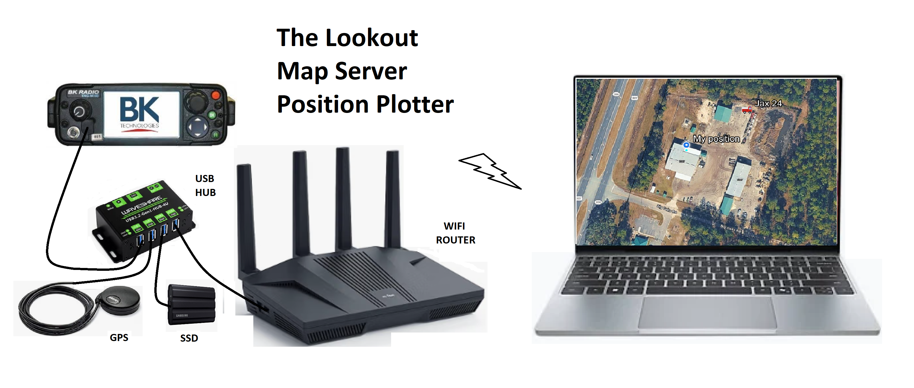
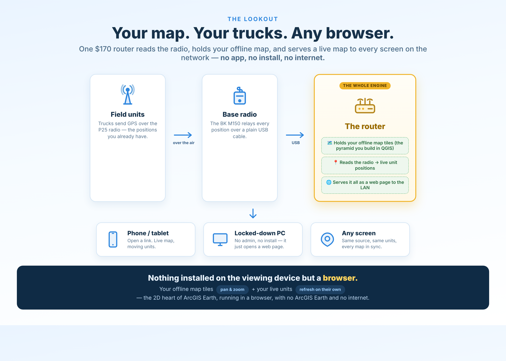
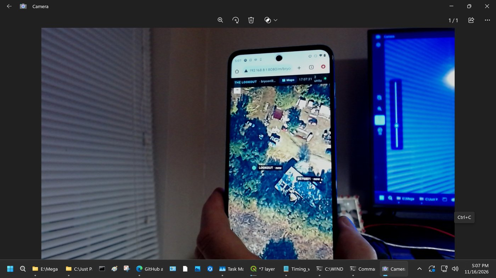
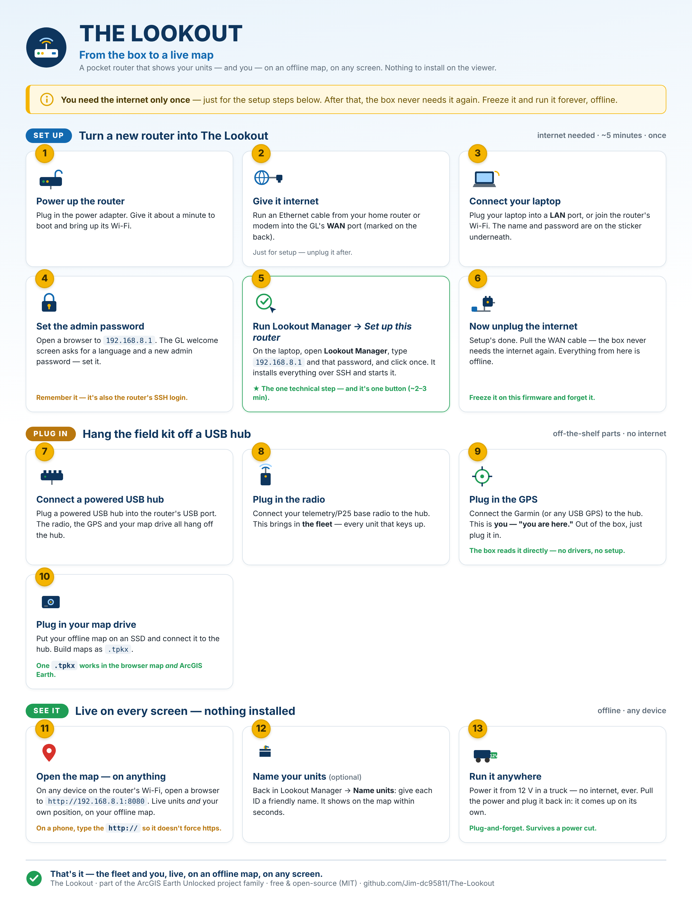
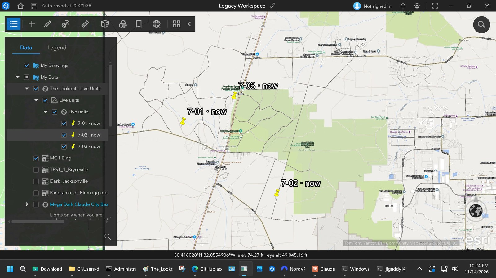
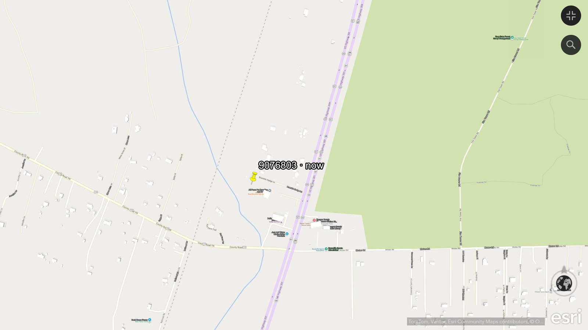

# The Lookout

**A pocket travel router turns P25 radio GPS into a live map on every screen — a browser, a phone, or ArcGIS Earth. Offline, no install, no cloud.**

🤖 **Using AI assistance?** Have the agent read the [CLAUDE.md](https://github.com/Jim-dc95811/ArcGIS-Earth-Unlocked/blob/main/CLAUDE.md) file first.

A GPS-telemetry radio already knows where your field units are — but that position is usually trapped: one cable, one PC, one program that has to be installed and allowed to run. **The Lookout** sets it free. A pocket travel router — a ~$170 **GL-MT6000** — reads the radio, pulls the position stream out, and re-serves it on your LAN so **any** device can watch — a plain browser, many ArcGIS Earth PCs, phones, tablets — all seeing the same units move, with nothing installed on the consuming machines.



---

## What it does

- **Reads the radio.** A GPS-telemetry base radio presents its received positions over a USB network link (RNDIS/CDC-Ethernet). The Lookout connects, subscribes, and reads the stream.
- **Cleans it up.** It pulls the standard NMEA sentences (`$GNGGA` position + a per-unit ID sentence) out of the radio's framing. The parser is frame-agnostic — it just finds and checksums the NMEA, so it works with any source that emits NMEA.
- **Serves it to everyone.** It re-broadcasts the clean feed on the network so many devices read one source at once:
  - **`:10110` — NMEA over TCP.** A plain NMEA-0183 stream any maps/NMEA app (phone, tablet, chart plotter, Windows tracker) can connect to.
  - **`:8080` — a live KML layer** (`units.kml`) that **ArcGIS Earth pulls on a timer** via a NetworkLink. This is the part that matters for locked-down PCs: it needs **no Python, no install, no admin** — you open one small map file once and the units move on their own.
- **Shows itself, too ("you are here").** Plug a USB GPS into the hub and the box plots its *own* position on the map alongside the fleet — read directly over libusb, no extra software. The radio feed is untouched; with no GPS it's simply radio-only. Setup: **[docs/GPS_SOURCE.md](docs/GPS_SOURCE.md)**. The full engineering story (reading a Garmin's binary USB protocol over libusb when gpsd and GPSBabel can't, on an OpenWrt router): **[docs/GARMIN_ON_OPENWRT.md](docs/GARMIN_ON_OPENWRT.md)** · **[printable PDF](docs/The_Lookout_Garmin_on_OpenWrt.pdf)**.
- **Runs itself.** Installed as a boot service, the Lookout comes up on its own every time the box powers on. Plug the radio in, power on, done.

## How it works (the picture above, left to right)

```
Field units  ──P25 GPS over the air──▶  Base radio  ──USB (RNDIS)──▶  THE LOOKOUT (router)  ──LAN──▶  every screen
                                                                         │ bk_bridge.py
                                                                         ├─ :8080  units.kml   → ArcGIS Earth (pull)
                                                                         └─ :10110 NMEA/TCP     → phones & apps
```

The router is the single source of truth; every ArcGIS Earth on the LAN is just a window into it. Each screen pulls on its own timer — **one source, many windows, same units on every map.** Scales from one PC to dozens without any special network setup: it's plain HTTP and TCP, nothing to enable, routes across subnets like any web request.

## Who it's for

The Lookout exists to reach the people a normal install can't:

| Client | How they consume | Needs installed |
|---|---|---|
| **Public / admin PC** | ArcGIS Earth, or any app | the full toolkit, if they want it |
| **Locked-down PC** (managed by Group Policy, no Python/admin) | ArcGIS Earth opens one NetworkLink KML → live units | **nothing** |
| **Smartphone / tablet** | ArcGIS Earth Mobile (KML) or an NMEA app (TCP) | a free app |

That second row is the whole point: a machine that can't install a thing still gets live positions, because the Lookout does all the work and the PC just opens a map file.

## 🌐 Live map in any browser — no app, no internet (NEW, 2026-11-15)



The router now serves a full **slippy map straight to any web browser** — your own offline map tiles (an `.mbtiles` pyramid *or* an Esri `.tpkx` — the very package ArcGIS Earth opens, no conversion) with the live units drawn on top. A locked-down PC, a phone, a tablet — each just opens **`http://<router>:8080/`**. Nothing installed, no internet. Functionally this is the 2D heart of ArcGIS Earth (an offline tile pyramid you pan and zoom, with a live overlay) running in a plain browser, with no ArcGIS Earth.

**Proven live** on a GL-MT6000, on a PC and an Android phone, with real P25 units riding on offline aerial imagery — nothing on the viewing device but a browser. Stress-tested at **46 GB of Z20** served off an external SSD.



*A smartphone with nothing installed but a browser, showing the live map served off the router — the box's own GPS (LOOKOUT) and a live field unit (9076801), both "now", on offline imagery. This is the whole point: a device that can't install a thing still sees live positions.*

**Many maps, one tap.** Drop several map files on the SSD and each gets its own link with a **Maps** menu to switch between them — your whole-area map, a county at Z20, a special incident map — live units riding on all of them, and units never move your view. Open `http://<router>:8080/`, hit **🗺 Maps**.

👉 Full build + how-to-reproduce record: **[docs/BROWSER_MAP.md](docs/BROWSER_MAP.md)** · **[printable PDF](docs/The_Lookout_Browser_Map.pdf)**

## What you need

1. **A travel router** (or any small Linux box) — the proven build is a **[GL-MT6000](https://www.gl-inet.com/products/gl-mt6000/)** (~$170); any OpenWrt router works, and a Raspberry Pi does too if you'd rather.
2. **A GPS-telemetry radio** that emits received positions as NMEA over a network or serial link. This was built and proven against a **BK M150** P25 base relay, but the NMEA parser is generic — any NMEA source works.
3. **[ArcGIS Earth](https://www.esri.com/en-us/arcgis/products/arcgis-earth/downloads)** (free) on the viewing machines, and/or a phone NMEA/maps app.

## Build it

**New to this? Follow the picture.** A box-to-live-map visual walkthrough — power up, set a password, one click, plug in the kit, open the map:



👉 **[Printable PDF of the steps](docs/graphics/lookout_install_pictogram.pdf)**

**Easiest — one click.** Use **Lookout Manager** (the Windows app, below): type the router's IP and admin password, click once, and it installs everything over SSH. See **[DEPLOY.md](DEPLOY.md)**.

**By hand on a GL-MT6000 (OpenWrt), radio plugged into USB:**

```sh
ssh root@192.168.8.1
opkg update && opkg install python3 libusb-1.0-0
cd /root
for f in bk_bridge.py gps_source.py garmin_linux.py units_kml.py; do wget -O $f https://raw.githubusercontent.com/Jim-dc95811/The-Lookout/main/$f; done
# install the procd boot services from openwrt/, then enable + start them:
/etc/init.d/bk-bridge enable && /etc/init.d/bk-bridge start
/etc/init.d/units-kml enable && /etc/init.d/units-kml start
```

Then on any viewer, read the feed at **`<router>:10110`** (NMEA), open **`http://<router>:8080/`** in a browser, or point ArcGIS Earth at the router's `units.kml`. Prefer a Raspberry Pi or another small Linux box? The same two scripts run there too — see **[docs/SETUP.md](docs/SETUP.md)**.

**Configure:** the radio's address, port, and the subscribe handshake live as plain constants at the top of [`bk_bridge.py`](bk_bridge.py) — edit them there for your setup.

## Live units in ArcGIS Earth

[`units_kml.py`](units_kml.py) turns the feed into a map layer. It reads the bridge's NMEA feed (so it never opens a second connection to the radio), tracks the latest position per unit, and serves a live `units.kml` on `:8080`.

```bash
python3 units_kml.py            # reads the bridge, serves units.kml on :8080
python3 units_kml.py --demo     # 3 moving synthetic units — watch it work with no radio
```

On any viewer, open **[`Live_Units.kml`](Live_Units.kml)** once in ArcGIS Earth (set the address in it to your Lookout's IP). ArcGIS Earth pulls `units.kml` every few seconds and the units move on their own — no install. Name units by dropping an `aliases.json` beside the script: `{"7101": "Engine 7", "7102": "Tanker 2"}`. Install it to start on boot alongside the bridge with [`units-kml.service`](units-kml.service).



*Confirmed live on ArcGIS Earth, 2026-11-14 — three named units served by the Lookout and moving on their own, nothing installed on the viewing PC (demo feed).*

## Status — what's proven

Straight about where this stands (measured, not assumed):

| Piece | State |
|---|---|
| Radio → clean NMEA on the network (`:10110`) | **Built and running** as a boot service; proven on the bench through connect → subscribe → serve, holding the radio steady. |
| ArcGIS Earth pulls a refreshing KML from the Lookout (`:8080`) | **Delivery proven live** — ArcGIS Earth 3.0.1 re-fetches a NetworkLink from the Lookout every 2 seconds on its own, across the LAN. |
| `units.kml` generated from the live feed (`:8080`) | **Built and confirmed live on ArcGIS Earth (2026-11-14).** Pipeline verified end to end (fake radio → bridge → `units_kml.py` → correct `units.kml`), then three named units served appeared and moved in ArcGIS Earth with nothing installed on the PC (screenshot above). |
| End-to-end with a live transmitting unit | **Proven live, 2026-11-15.** A real unit (ID `9076803`) keyed up and landed on ArcGIS Earth in Bryceville, FL — read off the radio, served over the LAN, consumed by a PC that had only a KML file. |
| Whole stack on a **GL-MT6000** travel router | **Proven live, 2026-11-15.** The bridge and the KML server both run on the router (OpenWrt); it reads the radio over USB and serves the live units to the LAN — no separate computer. |
| Comes back on its own after a power cut (router) | **Proven live, 2026-11-15.** Installed as OpenWrt `procd` boot services (`openwrt/`); a cold power-pull brought both services back with new PIDs and the unit reappeared on the map, nothing touched by hand. |
| The box plots its **own** position ("you are here") | **Proven live, 2026-11-16.** A Garmin GPS 18 USB on the router's hub, read directly over libusb (ctypes), put a `LOOKOUT` dot on the browser map in Bryceville, FL — on the same map as a live P25 field unit (`9076801`). 2 units, offline, nothing on the viewer. |

## Why a travel router

The whole Lookout runs on a single **GL-MT6000** travel router (OpenWrt): install Python (`opkg install python3`), pull the two scripts, and it reads the radio over USB and serves the LAN — no separate computer, no monitor, a built-in web admin page, and it runs off 12 V in a truck. A router already *is* a reachable network appliance, so there's no headless-networking headache, and it never needs the open internet after setup — so it can be frozen on a fixed firmware.



*A live P25 unit (`9076803`) served entirely by a GL-MT6000 router and shown in ArcGIS Earth, 2026-11-15 — Bryceville, FL. Nothing installed on the viewing PC but a KML file.*

## Hardening (v1.2)

The field build has been hardened and live-proven on the router:

- **Radio-link alarm.** The bridge watches its own link to the radio; the instant the USB cable is pulled (or the radio drops), a red **⚠ RADIO LINK DOWN** banner drops on the map in about a second — no waiting for units to go stale. A recovered map whose pins are still red is a *lingering alarm*: it tells the operator the link flickered. Reload the layer to clear it.
- **Plug-in after boot.** A hotplug handler re-addresses the radio's USB link whenever it appears, so the box tracks even if the radio is connected *after* power-on, not just during boot.
- **Daily track log.** Every fix is appended to `logs/track_YYYY-MM-DD.csv`, timestamped from the GPS fix itself when the radio sends `$..RMC` (accurate even if the box's own clock has drifted offline), otherwise from the box clock.
- **No single viewer can stall the feed.** A frozen or sleeping viewer is dropped instead of blocking everyone else.
- **Starts on boot, survives a power cut.** Installed as OpenWrt `procd` services (`openwrt/`), both come back on their own after a cold power cycle.

## Lookout Manager (the PC app)

`lookout_manager/` is a small Windows app (standard library + `paramiko` for SSH; the `.bat` installs it on first run) with two tabs:

- **Set up a router** — turn a brand-new GL-MT6000 into a Lookout in **one click**. Enter the router's IP and its admin password; the app logs in over SSH and installs everything — Python, both programs, the boot services, the hotplug handler — then starts and verifies them. The router needs internet for this one-time setup. *Proven from a full factory reset: blank router → set an admin password → one button → tracking, with nobody at a terminal.* See **[DEPLOY.md](DEPLOY.md)**.
- **Name units** — load the current unit-ID → name table, edit it, save it back. Names appear on the map within a few seconds, via a token-guarded `GET/POST /admin/aliases` endpoint on the KML server (`:8080`).

## Credits — a human–AI engineering collaboration

- **Jim Gaddy** — conceived it, directed it, and bench-tested every step. 37 years of radio and electronics; the one who knew the hardware inside out.
- **Claude** (Anthropic) — reverse-engineered the radio link, wrote the bridge, and built this out.

Built in the open so anyone can do the same with their own radio and their own router.

---

Part of the **[ArcGIS Earth Unlocked](https://github.com/Jim-dc95811/ArcGIS-Earth-Unlocked)** project family — tools that let you fly, map, and now *track* on offline ArcGIS Earth. Licensed MIT.
