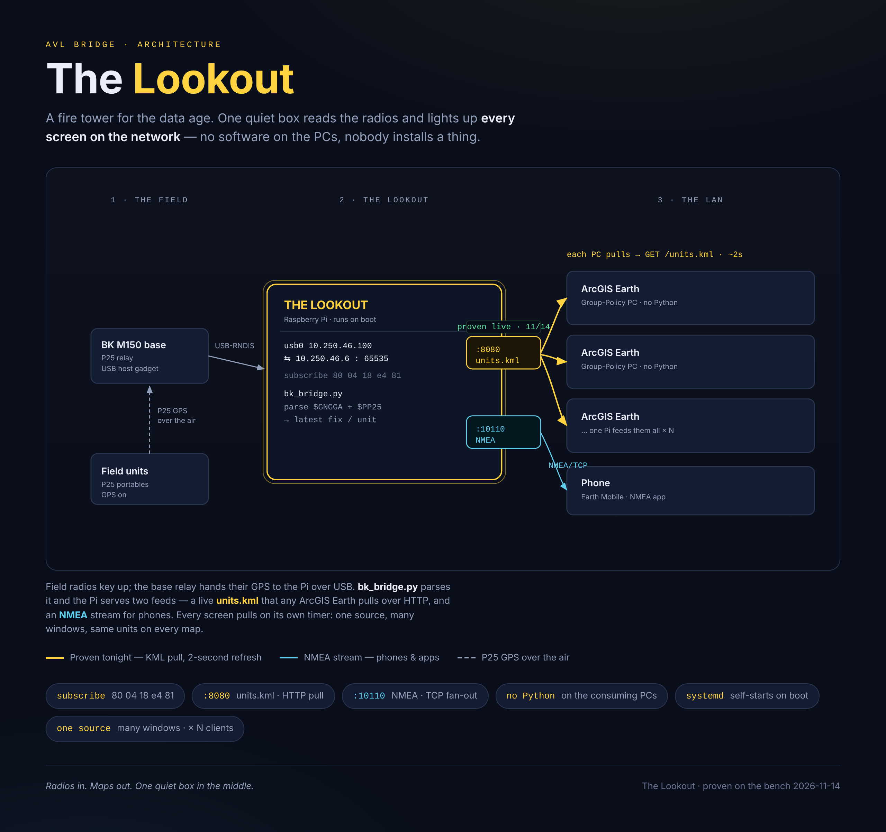

# The Lookout

**Using a Raspberry Pi as a GPS coordinate server — one quiet box reads the radios and lights up every screen on the network.**

🤖 **Using AI assistance?** Have the agent read the [CLAUDE.md](https://github.com/Jim-dc95811/ArcGIS-Earth-Unlocked/blob/main/CLAUDE.md) file first.

A GPS-telemetry radio already knows where your field units are — but that position is usually trapped: one cable, one PC, one program that has to be installed and allowed to run. **The Lookout** sets it free. A $35 Raspberry Pi reads the radio, pulls the position stream out, and re-serves it on your LAN so **any** device can watch — many ArcGIS Earth PCs, phones, tablets — all seeing the same units move, with nothing installed on the consuming machines.



---

## What it does

- **Reads the radio.** A GPS-telemetry base radio presents its received positions over a USB network link (RNDIS/CDC-Ethernet). The Pi connects, subscribes, and reads the stream.
- **Cleans it up.** It pulls the standard NMEA sentences (`$GNGGA` position + a per-unit ID sentence) out of the radio's framing. The parser is frame-agnostic — it just finds and checksums the NMEA, so it works with any source that emits NMEA.
- **Serves it to everyone.** It re-broadcasts the clean feed on the network so many devices read one source at once:
  - **`:10110` — NMEA over TCP.** A plain NMEA-0183 stream any maps/NMEA app (phone, tablet, chart plotter, Windows tracker) can connect to.
  - **`:8080` — a live KML layer** (`units.kml`) that **ArcGIS Earth pulls on a timer** via a NetworkLink. This is the part that matters for locked-down PCs: it needs **no Python, no install, no admin** — you open one small map file once and the units move on their own.
- **Runs itself.** Installed as a boot service, the Lookout comes up on its own every time the Pi powers on. Plug the radio in, power on, done.

## How it works (the picture above, left to right)

```
Field units  ──P25 GPS over the air──▶  Base radio  ──USB (RNDIS)──▶  THE LOOKOUT (Pi)  ──LAN──▶  every screen
                                                                         │ bk_bridge.py
                                                                         ├─ :8080  units.kml   → ArcGIS Earth (pull)
                                                                         └─ :10110 NMEA/TCP     → phones & apps
```

The Pi is the single source of truth; every ArcGIS Earth on the LAN is just a window into it. Each screen pulls on its own timer — **one source, many windows, same units on every map.** Scales from one PC to dozens without any special network setup: it's plain HTTP and TCP, nothing to enable, routes across subnets like any web request.

## Who it's for

The Lookout exists to reach the people a normal install can't:

| Client | How they consume | Needs installed |
|---|---|---|
| **Public / admin PC** | ArcGIS Earth, or any app | the full toolkit, if they want it |
| **Locked-down PC** (managed by Group Policy, no Python/admin) | ArcGIS Earth opens one NetworkLink KML → live units | **nothing** |
| **Smartphone / tablet** | ArcGIS Earth Mobile (KML) or an NMEA app (TCP) | a free app |

That second row is the whole point: a machine that can't install a thing still gets live positions, because the Pi does all the work and the PC just opens a map file.

## What you need

1. **A Raspberry Pi** — any model with USB and networking; a [Raspberry Pi 4](https://www.raspberrypi.com/products/) is more than enough.
2. **A GPS-telemetry radio** that emits received positions as NMEA over a network or serial link. This was built and proven against a **BK M150** P25 base relay, but the NMEA parser is generic — any NMEA source works.
3. **[ArcGIS Earth](https://www.esri.com/en-us/arcgis/products/arcgis-earth/downloads)** (free) on the viewing machines, and/or a phone NMEA/maps app.

## Build it

The full step-by-step — flash the Pi, enable SSH, bring up the radio link, install the boot service, and verify — is in **[docs/SETUP.md](docs/SETUP.md)**. The short version:

```bash
# on the Pi, with the radio plugged into USB:
scp bk_bridge.py  pi@<your-pi>:~          # copy the bridge over (run from your PC)
sudo cp bk-bridge.service /etc/systemd/system/
sudo systemctl enable --now bk-bridge     # install + start the boot service
journalctl -u bk-bridge -f                # watch it hold the radio
```

Then on any viewer, read the feed at **`<your-pi>:10110`** (NMEA) or point ArcGIS Earth at the Pi's `units.kml` (KML pull).

**Configure:** the radio's address, port, and the subscribe handshake live as plain constants at the top of [`bk_bridge.py`](bk_bridge.py) — edit them there for your setup.

## Live units in ArcGIS Earth

[`units_kml.py`](units_kml.py) turns the feed into a map layer. It reads the bridge's NMEA feed (so it never opens a second connection to the radio), tracks the latest position per unit, and serves a live `units.kml` on `:8080`.

```bash
python3 units_kml.py            # reads the bridge, serves units.kml on :8080
python3 units_kml.py --demo     # 3 moving synthetic units — watch it work with no radio
```

On any viewer, open **[`Live_Units.kml`](Live_Units.kml)** once in ArcGIS Earth (set `PI-IP` in it to your Pi's address). ArcGIS Earth pulls `units.kml` every few seconds and the units move on their own — no install. Name units by dropping an `aliases.json` beside the script: `{"7101": "Engine 7", "7102": "Tanker 2"}`. Install it to start on boot alongside the bridge with [`units-kml.service`](units-kml.service).

## Status — what's proven

Straight about where this stands (measured, not assumed):

| Piece | State |
|---|---|
| Radio → clean NMEA on the network (`:10110`) | **Built and running** as a boot service; proven on the bench through connect → subscribe → serve, holding the radio steady. |
| ArcGIS Earth pulls a refreshing KML from the Pi (`:8080`) | **Delivery proven live** — ArcGIS Earth 3.0.1 re-fetches a NetworkLink from the Pi every 2 seconds on its own, across the LAN. |
| `units.kml` generated from the live feed (`:8080`) | **Built — pipeline proven.** Fake radio → bridge → `units_kml.py` → a correct `units.kml` was verified end to end; `--demo` mode shows it live on a real ArcGIS Earth with no radio. |
| End-to-end with a transmitting field unit | **Pending** — needs a unit keying up in the field (bench has only the base relay). |

## Credits — a human–AI engineering collaboration

- **Jim Gaddy** — conceived it, directed it, and bench-tested every step. 37 years of radio and electronics; the one who knew the hardware inside out.
- **Claude** (Anthropic) — reverse-engineered the radio link, wrote the bridge, and built this out.

Built in the open so anyone can do the same with their own radio and their own Pi.

---

Part of the **[ArcGIS Earth Unlocked](https://github.com/Jim-dc95811/ArcGIS-Earth-Unlocked)** project family — tools that let you fly, map, and now *track* on offline ArcGIS Earth. Licensed MIT.
