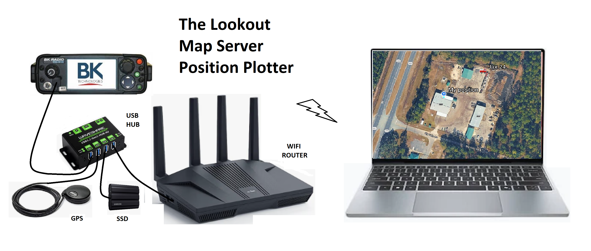

# The Lookout — Live Map in Any Browser (no app, no internet)



**Proven live 2026-11-15** on a GL-MT6000 router, on a PC and an Android phone, with real P25 units (9076801, 9076803) riding on Bryceville aerial imagery — nothing installed on the viewing devices but a web browser. The same day it went further: the router served a **46 GB Z20 Esri `.tpkx`** — the exact tile package ArcGIS Earth opens, with no conversion — straight off an external SSD, at full Z20 detail and smooth zoom, to a PC and a phone.

This document is the permanent record of what was built, why it matters, and exactly how to stand it up again. Code lives on **`main`** (`units_kml.py` **v1.10** + `map.html` + `leaflet.js` + `leaflet.css`) — made official 2026-11-15. v1.10 adds **many maps, one per link** (§3).

---

## 1. What it is, in one line

**The router serves a real slippy map — your own offline map tiles with your live units on top — straight to any device's web browser.** No ArcGIS Earth, no app install, no cloud, no internet.

Put plainly: this is the 2D heart of ArcGIS Earth (an offline multiresolution tile pyramid you can pan and zoom, with a live overlay) running in a plain browser. The tile pyramid is the `.mbtiles` file you already make in QGIS; the pan/zoom engine is Leaflet, the same standard machinery behind every web map. The router wires your pyramid to that engine and draws the live P25 feed on top.

## 2. Why it matters

- **It reaches every device with zero install.** A locked-down, Group-Policy PC with no admin and no Python? It opens a link. A phone or tablet? It opens a link. Same live map on every screen.
- **It fits the mission:** *don't make the user learn GIS before they can use geography.* Nobody installs or learns an app. They open a URL and see the map.
- **It sidesteps ArcGIS Earth mobile's walls entirely.** AE mobile refuses plain `http://`, won't trust a self-signed cert, and only takes URLs from ArcGIS Online / Enterprise — so a self-hosted live LAN feed can't get in. A browser doesn't care. (Full research record: AE mobile was a dead end for a live self-hosted feed; the browser is the answer.)
- **It serves the very tile packages ArcGIS Earth uses — no conversion.** Since v1.9 the router reads tiles straight out of an Esri `.tpkx` (Compact Cache V2, exactly what `mb2tpkx` writes). The map file you already built for ArcGIS Earth *is* the file the browser serves. Proven at 46 GB of Z20 off an SSD (see §7).

What it is **not**: no 3D globe or terrain, no Esri/Living Atlas data ecosystem, no KML authoring. It is 2D tiles + live points. ArcGIS Earth still owns the rest — this is a new, dead-simple *delivery channel*, not a replacement.

**Why it can out-run ArcGIS Earth at this one job.** It isn't magic and it isn't a better GIS — it's doing far less. ArcGIS Earth is a 3D globe: terrain mesh, draping, reprojection, a whole authoring and data ecosystem riding along. The browser map draws 2D raster tiles only — seek to the tile in the package, hand the raw JPEG to Leaflet, draw the units on top. No globe math, no decode-and-recompress, no weight. For the one thing most field users actually need — *look at the map, see the units* — stripping the problem down to its 2D heart is exactly why it flies. Keep ArcGIS Earth for the globe, the KML authoring and the Esri data; this is the delivery truck that reaches the crew who would never open the globe.

## 3. How it works

```
Field units ──P25 GPS over the air──▶ BK M150 base ──USB (RNDIS)──▶ GL-MT6000 router ──LAN──▶ any web browser
                                                                      │ bk_bridge.py  (reads radio, serves NMEA :10110)
                                                                      │ units_kml.py  (:8080):
                                                                      │   /                → map.html (Leaflet page)
                                                                      │   /leaflet.js /leaflet.css  (bundled, local — no CDN)
                                                                      │   /maps.json       → every map on the SSD (alphabetical)
                                                                      │   /m/<slug>/meta.json         → that map's bounds + zoom range
                                                                      │   /m/<slug>/tiles/{z}/{x}/{y} → tiles out of that map
                                                                      │   /units.json      → live unit positions (polled every 3s)
                                                                      └   maps live on the SSD  (.tpkx / .mbtiles from QGIS)
```

The browser loads `map.html`, which starts a Leaflet map, reads `/maps.json` to learn which map this page shows (at `/` that's the first one alphabetically), adds a raster tile layer pointing at that map's `/m/<slug>/tiles/{z}/{x}/{y}` (so Leaflet pulls the right pyramid level as you zoom), and every 3 seconds re-fetches `/units.json` and moves the unit markers. All of it is served by the router; the browser reaches nothing else.

### Key technical facts (don't lose these)
- **The basemap is an MBTiles file** — a SQLite database of pre-rendered map tiles at many zoom levels (a multiresolution pyramid). This is exactly what QGIS exports and what feeds `mb2tpkx`. The router reads tiles out of it directly; no conversion needed.
- **TMS → XYZ row flip.** MBTiles stores tile rows TMS-style (row 0 at the south); Leaflet/XYZ asks with row 0 at the north. The server flips: `tms_row = (2^z − 1) − y`. (This is the same flip `mb2tpkx` already does.)
- **Leaflet 1.9.4 is bundled on the router** (`/leaflet.js`, `/leaflet.css`) and served locally, so the page needs no internet and no CDN.
- **`/m/<slug>/meta.json`** hands the page each map's `bounds`, `minzoom`, `maxzoom` so the map fits the right area and zoom range automatically.
- **No default map — the router holds none (v1.12).** The box stores **no** map and has no "default" or privileged basemap: no symlink, nothing read from internal flash. It scans whatever removable drive is mounted (`/tmp/mountd/*`; override/extend with `LOOKOUT_MAP_ROOTS`) and serves every `.tpkx`/`.mbtiles` it finds, all equal, each at `/m/<slug>/`, **sorted alphabetically by file name**. The bare URL `/` just shows whichever map sorts first — crews control that by naming (prefix a file `1_`/`a_`). Swap drives freely; the box stays generic.
- **Graceful with no map:** if the drive is empty or out, `/maps.json` is empty, the menu says "No maps found · insert an SSD," and the units simply draw on a blank background — no crash.
- **TPKX is supported too (v1.9).** The server reads tiles straight out of an Esri **`.tpkx`** (Compact Cache V2 — exactly what `mb2tpkx` writes), so it serves the **same tile packages ArcGIS Earth uses, with no conversion**. Backend chosen by extension. Bundle path `tile/L{zz}/R{row:hex}C{col:hex}.bundle`; 8-byte index record = offset (low 40 bits) + size (high bits); row-major; **no TMS flip** (TPKX stores rows north-down already); MIXED JPEG/PNG sniffed per tile. Direct-seek reader, thread-safe, reboot-safe. Just drop it on the SSD — no symlink, no config.
- **Many maps, one per link (v1.10; all equal since v1.12).** Every `.tpkx`/`.mbtiles` on the SSD is served at its own URL `/m/<slug>/` with the live units on top; `/maps.json` lists them and the page carries a **Maps** menu to jump between them. Two viewers can be on different maps at once, and a new map file dropped on the drive shows up in the menu within ~10 s (no restart). Each map is named after its file. **Units never move the view** — IDs key up from all over, so the map stays exactly where you put it. LIVE-PROVEN on the router 2026-11-15 (tap to switch county maps; a unit keying up never hijacks the view).

## 4. How to reproduce it (deploy to a router)

Assumes The Lookout is already installed on the router (bk-bridge + units-kml boot services) and you can `ssh root@192.168.8.1`.

**Step 1 — put your maps on the SSD.** Any `.tpkx` or `.mbtiles` covering your units' area (made in QGIS / `mb2tpkx`). Drop them on the **root of the SSD** — nothing goes on the router, and there's no "default" to set. The menu order and which map the bare URL opens first are plain alphabetical by file name, so name them to taste (prefix `a_`/`b_` or `1_`/`2_`):
```
<SSD>:\a_Nassau_Z20.tpkx     ← sorts first, so "/" opens this one
<SSD>:\b_Area_Z18.tpkx
<SSD>:\c_Streets.mbtiles
```
Insert the SSD into the (powered) hub; the router auto-mounts it and the maps appear in the **🗺 Maps** menu within ~10 s — no symlink, no restart.

**Step 2 — pull the v1.10 code and restart.**
```
ssh root@192.168.8.1 "cd /root && \
  wget -O units_kml.py https://raw.githubusercontent.com/Jim-dc95811/The-Lookout/main/units_kml.py && \
  wget -O leaflet.js  https://raw.githubusercontent.com/Jim-dc95811/The-Lookout/main/leaflet.js && \
  wget -O leaflet.css https://raw.githubusercontent.com/Jim-dc95811/The-Lookout/main/leaflet.css && \
  wget -O map.html    https://raw.githubusercontent.com/Jim-dc95811/The-Lookout/main/map.html && \
  /etc/init.d/units-kml restart && echo UPDATED"
```

**Step 3 — open it.** In any browser on the router's network:
```
http://192.168.8.1:8080/
```
Type the `http://` on purpose (see gotcha below). You'll see your tiles with the live units on top.

## 5. Gotchas learned the hard way

- **Phone browsers force HTTPS.** Typing `192.168.8.1:8080` gets silently upgraded to `https://…`, which the http-only server can't answer → "refused to connect." Fix: type `http://192.168.8.1:8080/` explicitly, or hand out a **QR code** that encodes the full `http://` URL (recommended for crews — no typing, no upgrade).
- **ArcGIS Earth mobile can't be the client.** It refuses http, won't trust self-signed https, and only accepts ArcGIS Online/Enterprise URLs. The browser is the way in. (AE mobile is still fine as an *offline basemap viewer* for your TPKX.)
- **`scp` fails to the router** (no sftp-server on dropbear). Use `ssh "cat > dest" < localfile`.
- **A basemap only covers its own area.** Units that roam outside the MBTiles bounds land on black. For wider coverage, use a larger map (or multiple). The Bryceville test file covers only `-81.958,30.3838 → -81.9203,30.3961` (zoom 8–20, JPEG).

## 6. Status and what's left

**Status:** `units_kml.py` **v1.10** is LIVE-PROVEN on the GL-MT6000 (2026-11-15) on PC and phone — served from the router's internal flash, from an external SSD, and from both basemap formats: an **MBTiles** pyramid *and* an Esri **`.tpkx`** (the same package ArcGIS Earth opens, no conversion). High-water mark: a **46 GB Z20 `.tpkx`** served off the SSD at full detail and smooth zoom. **v1.10 adds the Maps menu** — every map file on the SSD served at its own link, units never moving the view — live-proven on the router 2026-11-15. Merged to **`main`** and made official. Reboot-survival services are in place (v1.8 boot-ordering safety, §7). **v1.12 (2026-11-16): no default map** — the router carries none and serves whatever maps are on the SSD, all equal, alphabetical (name `a_`/`1_` to order); the `basemap` symlink is retired. Shipped with field hardening (bridge v1.4 idle-safe link alarm; units v1.11 SSD-removal resilience). LIVE-PROVEN on the router 2026-11-16.

**In progress (2026-11-15):** a single whole-area **Z19** package covering a 2°×2° box (≈4 counties) building in QGIS — expected on the order of **100–150 GB**, to be served the same way. When it lands, verify the total file size and that all four corners of the box actually carry imagery (a long, slow basemap fetch can leave edges blank).

**Polish / next (none urgent):**
- Zoom control sits partly under the top header bar — nudge it down.
- Unit labels overlap/clip when two units are very close — offset or collision-handle them.
- **QR code** that opens `http://<router>:8080/` — the right crew-onboarding tool (and it kills the `http://` typing gotcha).
- ~~Fold the basemap step into the setup flow / Lookout Manager.~~ — **moot (v1.12): there is no basemap step.** Maps just go on the SSD root; the router finds them, orders them by name, and needs no symlink or config.
- **Explore other router makes/models.** The core is stdlib Python + OpenWrt `procd` services; the GL.iNet bits (USB auto-mount, admin page, one-click Lookout Manager) are conveniences, not dependencies. A candidate just needs OpenWrt/`python3`, a USB port (radio + SSD) and a little RAM. Tiers: (1) other **GL.iNet** models — same firmware, Lookout Manager works unchanged; pick by price/ports/CPU. (2) a **cellular** model (Spitz-class) — the box becomes radio→map *and* the crew's internet uplink + a remote-reachable node (a real capability jump). (3) any **OpenWrt** router — doable, but we'd handle the USB mount + radio link + init scripts ourselves, and the one-click setup would need a per-model path.
- ~~Bigger / multiple basemaps for wider coverage; a way to pick which map file is active.~~ — **done 2026-11-15 (v1.10): every map on the SSD at its own `/m/<slug>/` link + a Maps menu (§3); v1.12 made them all equal — no default, ordered by file name.**
- ~~Merge `browser-map-wip` into `main`~~ — **done 2026-11-15; v1.9 is on `main`.** The `browser-map-wip` branch is now redundant and can be deleted.

## 7. Big storage: external SSD on a powered hub (statewide)

The router's internal flash caps the basemap at a few hundred MB. To hold a whole region's Z20 imagery, put the map on an **external SSD** and serve tiles straight off it. **Proven live 2026-11-15** on a Samsung T5 (465 GB), with the radio and the SSD sharing the router's one port through a powered industrial hub — PC and phone, serving entirely off the SSD. The high-water test: a **46 GB Z20 `.tpkx`** (one 1° county) served flawlessly — full Z20 detail *and* a smooth regional zoom-out — straight off the T5.

**Storage math (measured / estimated, honest).** At JPEG q75 these run roughly: **~46 GB per 1° county at Z20** (measured); a 2°×2° area (≈4 counties) ≈ **~100–150 GB at Z19**, ≈ **~600 GB at Z20** (needs a 1 TB drive), ≈ **~40 GB at Z18**. Z19 over the whole area fits the 465 GB T5 with room; Z20 over the whole area does not.

**Hardware**
- **Powered USB hub** on the router's single USB 3.0 port (a USB 2.0 hub is fine — serving map tiles is thousands of tiny random reads, nowhere near USB 2.0's ceiling). It **must be externally powered** — the router's port can't reliably feed a radio *and* a drive. An industrial hub with a 7–24 V terminal block (e.g. StarTech ST4200USBM, ~500 mA/port, 10 W total) lets the whole rig — router, hub, radio, SSD — run off **12 V vehicle power**.
- Radio and SSD both plug into the hub. The radio re-enumerates behind the hub on its own (the `usb0` hotplug handler re-addresses it to `10.250.46.100`).
- Use an **SSD, not a spinning HDD** (spin-up current); a low-power USB SSD (Samsung T5/T7) fits the per-port budget with room.

**Filesystem:** format the SSD **NTFS** (officially supported by GL firmware, handles multi-GB single files — avoid FAT32's 4 GB file limit). exFAT also works on the Flint 2.

**Nothing to point at it (v1.12).** GL firmware auto-mounts USB storage under `/tmp/mountd/disk1_part1/`, and the server scans there on its own — no symlink, no config, no restart. Drop your maps on the SSD root and they appear in the **🗺 Maps** menu within ~10 s. (Confirm what's mounted with `find /tmp/mountd -iname '*.tpkx' -o -iname '*.mbtiles'`.) Drop your full statewide `.tpkx` on the SSD and it serves the same way — the box just reads a bigger file.

**Reboot safety (v1.8).** On a cold boot the map service can start a moment before GL's USB auto-mount finishes. v1.8 handles it: the server never caches a "no basemap" result, and the page keeps polling `/meta.json`, so the map appears the instant the SSD is mounted — no restart, no blank map. Survives a power-cycle in a truck.

---

*Built by Jim Gaddy (concept, direction, field hardware and testing) with Claude (reverse-engineering, server, and this build). Part of the ArcGIS Earth Unlocked project family.*
