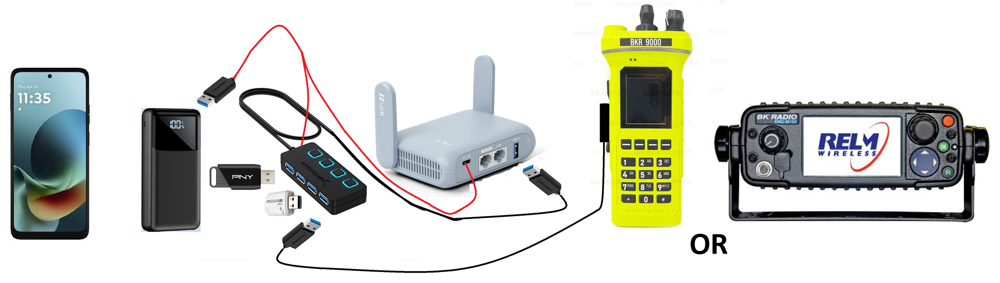
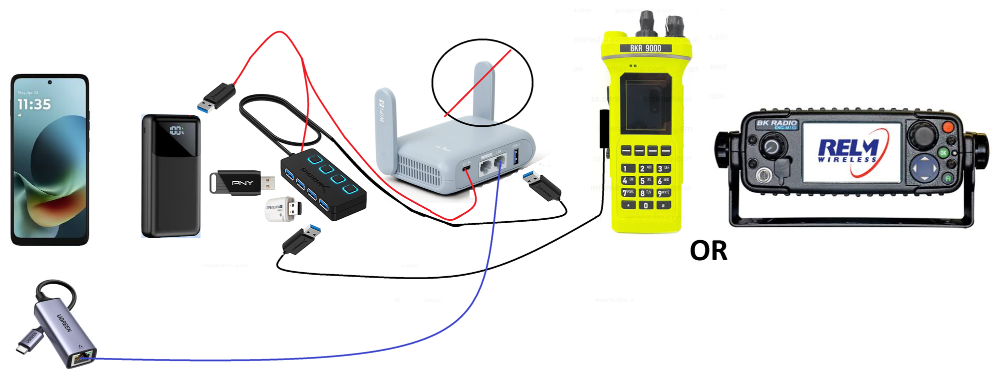

# The Lookout — Journal of Ideas

Captured ideas for later, not built yet. Newest first. An entry here is a
direction to weigh, not a committed plan.

---

## Two removable drives — basemaps vs. situational content — *2026-11-20*

**The idea (Jim, "record this for testing"):** with a spare port on the hub, run
**two thumb drives** instead of one, split by job:
- **Drive 1 = basemaps** — the stable `.tpkx`/`.mbtiles` the map serves. Rarely
  changes; the greeter + whatever areas the box carries.
- **Drive 2 = "everything else, on a situational need"** — incident/situational
  content (docs, photos, reference, situational data — the Signal Shed content
  paths), swapped per incident.

**Why it's good:** physical separation of the **stable** layer from the **volatile**
layer. A crew **hot-swaps the situational drive** for a given incident — pull Drive
2, plug in that incident's Drive 2 — without ever touching the basemaps. Pure
removable-media, no GUI, fits the "name to order, nothing on the box" model.

**To test / resolve:**
- `units_kml` already scans `/tmp/mountd/*` for every `.tpkx`/`.mbtiles`, so **two
  drives' worth of maps already merge** into the Maps list for free — confirm it,
  and confirm a drive with **no** maps (Drive 2) doesn't choke the scan.
- **How Drive 2's non-map content is served** is the open design question: does
  `units_kml` serve arbitrary files from a mount, or does a small content server own
  Drive 2? This is the Signal Shed content-platform work (field-photo / content-lab
  paths) meeting the storage split. One server keyed by file-type (maps vs content)
  vs. two servers — decide on the bench.
- **Hot-swap behavior:** pull/insert Drive 2 mid-run — does the box notice the
  mount/unmount and refresh the list? (The `usb0` hotplug handler is the pattern.)
- **Label the sticks physically** so a crew never guesses which is which.

---

## The Lookout Traveler — a man-packable, battery Lookout — *2026-11-19*

> **UPDATE 2026-11-20 — the Traveler is now built on the GL-MT3000, not the Pi.**
> Jim parked the Pi for now ("forget the pi altogether for now, we are focused on
> the Traveler using the MT-3000"). Why it's the better call: **one platform for both
> boxes** — everything proven on the MT6000 carries straight over, same code, same
> one-click — and, decisively, **the GL is self-serve** (a buyer can stand it up
> alone with the manual + one button) while **the Pi needs AI assistance** to set up
> (flash, hostapd, hardening). That self-serve line is the whole product. The MT3000
> (512 MB RAM, WiFi 6, ~$84) has huge headroom for the light stack (measured footprint
> ~23 MB; perf checks showed only a small % of RAM used). GPS is still the **VK172
> u-blox on the serial path**; audio still dropped. The one consequence of using the
> GL: it's **1 USB port**, so the Traveler keeps a **powered hub** (USB-fed from the
> PD bank — Jim has USB-C power pigtails) for SSD + GPS + radio — the hub the Pi's 4
> ports would have avoided. The Pi reasoning below is kept as the record of why it
> was weighed; **the Pi's real home is the Signal Shed bench, not the product.**

**Physical build (Jim's layout, 2026-11-20) — two configs.**

*Standard (phone on Wi-Fi):*

Phone joins the box's **Wi-Fi**. Radio → **powered USB hub** → the router's single
USB3 port (**data only**). The hub is self-powered from the 5 V rail (its own
17 W / 2.5 A input, fed by a USB-C pigtail) and carries the radio + **VK172 u-blox
GPS** + thumb drive(s) downstream, so the one router port never has to source their
current. Donor radio = **BKR9000** handheld **or** **KNG-M150** mobile.

*Battery-saving (phone wired, Wi-Fi off):*

Router **Wi-Fi radio off** (slashed antenna) and the phone wired in through a
**USB-C→Ethernet adapter** on the LAN port. This kills **both** Wi-Fi radios — the
box's AP (one of the steadiest draws in the whole unit) and the phone's — for the
biggest single power saving, and gives a rock-steady wired link with no RF
congestion. It also unlocks a **Wi-Fi-less / LTE-less tablet** as a pure display.
Note this is the **supported** side of Android USB networking: a phone *hosting* a
standard Ethernet adapter is adopted as `eth0` natively — the opposite of reading
an RNDIS gadget, which Android can't do. If the phone needs charging while wired,
use an adapter with **USB-C PD pass-through**.

**The idea (named by Jim):** the fully-wireless, walk-around Lookout. A 12 V Li
battery runs the brain; a **portable radio** (on its own battery) is the relay;
a small GPS gives "you are here"; your **phone is the screen** over the box's own
Wi-Fi. Put it in a backpack and track the whole fleet as you walk the incident.
The fixed Lookout lives in a vehicle or on a bench; the **Traveler** rides on your
back.

**The use case that sells it (Jim's own pitch):** the leader who leaves the truck
to actually lead — pushes a line on a quad, walks a flank on foot — normally goes
*blind*, because the display stays in the cab. The Traveler puts the whole picture
in their pocket: every unit the system can hear, live, while they move. It's the
firefighter-safety / GPS-off-the-radio goal (the "Holy Grail") **un-bolted from a
vehicle and carried into the fire** — accountability that follows the leader.
"Captain Smith keeps his people on his phone." (Coverage is the agency's **repeater
footprint**, not line-of-sight — the relay just needs clean copy of the repeater,
so a stubby is fine; the network does the long haul.)

**This is the Pi's home.** The Pi started the whole project (the first Bridge) then
got benched because the GL router is the better *crew-deployable* appliance
(reachable, web admin). But the Traveler's defining constraint is **battery
runtime**, and that's exactly where the Pi wins:
- **Power:** Pi 4 ~3-5 W vs the GL ~7-9 W — the single biggest lever on a backpack.
  Same battery → a fuller day; same runtime → half the battery weight.
- **No hub:** the hub existed only because the GL has *one* USB port. The Pi has
  four — radio-data, sound card, GPS, storage each get their own.
- **Smaller + simpler GPS:** a tiny u-blox USB dongle speaks plain **NMEA** over
  serial, which `gps_source.py` already reads — no Garmin D800/libusb path at all.
- **Audio is easier:** full Raspberry Pi OS has USB-audio/ALSA built in — plug the
  sound card in, `arecord` + `lookout_audio.py` just run. None of the GL
  kernel-matched `kmod-usb-audio` dance.
- **The Pi's old weakness doesn't bite here:** the "headless, can't-reach-it" wall
  was a *crew-deployment* problem. The Traveler is personal gear, set up once by its
  owner — the quirk is a non-issue.

**The one build task that moves the other way:** the Pi must become its own **Wi-Fi
hotspot** (hostapd + dnsmasq) so the phone can join — the GL is a router out of the
box, the Pi isn't. Easy, and the Pi's modest onboard Wi-Fi range is plenty serving
one or a few phones.

**Power budget / runtime (ballpark — measure with an inline 12 V watt meter to nail
it):** off the pack, Pi 4 + sound + GPS + thumb-drive ≈ **8-11 W** (the GL build was
~13-15 W). The portable runs on its own battery (receive-only handhelds do a full
shift), so it's basically free to the pack. → a **~150 Wh** (~1 lb) 12 V pack ≈ **a
full shift**; ~72 Wh ≈ half a shift; ~240 Wh ≈ two shifts.

**The product line this creates:**
- **The Lookout** → GL-MT6000 router. Reachable appliance, crew-proof, vehicle/mains.
- **The Lookout Traveler** → Raspberry Pi. Lowest power, smallest, personal, battery,
  man-packable.
Same brain (`bk_bridge` + `units_kml` + `lookout_audio`), two bodies.

**Still to prove (build order, buildable here + bench):** Pi-as-hotspot
(hostapd/dnsmasq) serving the three services; the u-blox NMEA dongle through
`gps_source.py`'s serial path; audio via standard ALSA on Pi OS; then a real
battery-runtime measurement. The portable-radio-as-relay (vs a base/mobile radio)
is proven in concept — a handheld on the system receives the same forwarded packets.

**Simplification (Jim, 2026-11-19 night): the Traveler needs NO sound card / audio
streaming.** The operator *wears* the portable, so they just listen to its own
speaker — the Traveler's job is the **map**. The portable isn't in the pack either;
it's carried normally, tethered to the Pi by the single USB data link (RNDIS) that
carries the position packets. So the Traveler reduces to its essentials: **Pi + PD
power bank + VK172 (u-blox) GPS + Wi-Fi hotspot + `bk_bridge`/`units_kml`** — drop
`lookout_audio` and the USB sound card entirely. Lighter, fewer parts, one less
thing to configure. (Parts ordered 2026-11-19: seaistar PD‑30W power bank + HiLetgo
VK172 u-blox‑7 USB GPS; Pi + Talentcell 12 V LiFePO4 already on hand.)

---

## Field photo report — phone sends a pic back to the box — *2026-11-17*

**The idea (Jim):** the realistic reverse-path — not live video (that's the
moonshot at the end), just a **still photo or screenshot** sent from a phone
*to* the box. **Primary use case: a teacher (or any presenter) shares a photo
from her phone** — she sends it to the SSD and it's **quickly available from
the Maps drop-down list**, so anyone in the room taps it and views it. (The
same move also serves a field photo report — "washout on the north road"
plus a pic — but the everyday driver is sharing a picture to a room.)

**It's a shared board, not just a share (Jim):** the same mechanism makes it
**many-to-many** — *anyone* on the Wi-Fi can contribute a pic and it's
visible to everyone else right away (the picker's ~10 s refresh gives the
live feel for free). That's a **local, offline, no-account, no-app, cross-
platform shared photo board** — a combination that's genuinely hard to get
elsewhere (AirDrop is Apple-only; cloud albums need accounts + internet).
For a classroom it's also a privacy win: the pool never leaves the box, so
no cloud is harvesting a minor's photos. Posture: with many writers, trust =
whoever holds the Wi-Fi password (the joined group); fine for a controlled
room, no logins needed; lean harder on images-only + size/storage caps + the
isolated uploader, and consider an optional contributor name on each pic.

**How it surfaces — reuse the Maps dropdown (the key simplification):** the
content picker already scans the SSD and refreshes every ~10 s. An uploaded
photo drops into that *same* list as another selectable item — **no new
browsing UI.** Tap it and the browser just displays the JPEG (pinch-zoom
works natively; no tiling needed for a quick share — tiling is only for the
giant picture-worlds). The new parts are small: an upload endpoint that
writes the file to the SSD, and the list/viewer recognizing an image file as
a viewable entry alongside the maps.

**Why it's easy — easier than talk-back audio:**
- **No HTTPS wall.** Live mic/camera need `getUserMedia` (a secure context),
  which is blocked on the box's plain http. A **photo upload uses a plain
  file input** (`<input type="file" accept="image/*">` — optionally
  `capture` to open the camera, or just pick from the gallery), which works
  over ordinary http. The reverse-image path walks right past the wall that
  stops reverse-audio.
- **No encoding, no bandwidth ceiling.** A phone photo is already a
  compressed JPEG (a few MB); a one-time POST the router handles without
  noticing. None of the video headaches.

**Storage target = the map SSD (Jim's call), not the router's flash:**
- **Capacity** — internal flash is tiny (OS only); the SSD has tens to
  hundreds of GB.
- **Flash durability** — writing user uploads to the router's overlay flash
  invites wear and the sync-to-commit landmine we hit with audio; the SSD is
  built for writes.
- **Portability / stateless box** — the SSD already carries the maps
  (`units_kml` serves from `/tmp/mountd/*`). Photos live beside them, travel
  with the drive, and get pulled off after an incident by just taking the
  SSD. The router stays stateless firmware; the SSD is the data volume. Fits
  the "no default map, the SSD carries everything" design.

**Implementation notes / honest caveats:**
- **The SSD must be present AND writable.** No SSD (the "no maps found"
  state) = nowhere to store; disable upload and say "insert an SSD." The
  live SSD was **NTFS** — writing NTFS/exFAT on OpenWrt needs `ntfs-3g` /
  exfat write support, and a map mount may be read-only for safety, so the
  uploader needs a read-write mount. Flag this early.
- **Dedicated folder + storage cap.** Put uploads in e.g. `<drive>/photos/`,
  named by timestamp (+ optional unit / caption). Cap the size or rotate by
  date so photos can't fill the drive and starve map serving — tiles are the
  priority.
- **Removal resilience.** If the SSD is pulled mid-upload, fail gracefully
  (SSD-yank resilience already matters for tile reads).

**Posture shift — write it down:** this is the **first feature where a phone
*writes* to the box** — read-only becomes read/write. Still offline, still
on the island, nothing leaves. But anyone on the shared-password Wi-Fi can
post, so: **images only, size-capped, and keep the uploader its own isolated
process** (same wall as the audio streamer) so it can never touch the map,
the feed, or the audio.

**The video moonshot (separate — not this):** live video *could* relay
through the box the way audio does — but only if the **source encodes** it
(a camera/drone/phone outputting H.264/MJPEG → box relays → browser decodes).
The box must **never** encode raw video (the router CPU can't). Browser
camera capture also hits the HTTPS wall, and bandwidth (megabits × many
viewers) is the real ceiling. MJPEG-over-HTTP is the simplest first version.
Parked as "possible, but the photo-back above is the thing to actually
build."

---

## Info kiosk — scan-to-open, any content, offline — *2026-11-17*

**The idea (Jim):** The Lookout + the printed QR card = a self-contained
**info kiosk**. Set the box somewhere, print the QR placard, and anyone who
walks up scans it and gets a local page on their own phone — no app, no cell
signal, no login, no internet. The content doesn't have to be a map.

**Two generalizations that make it a kiosk, not just a map server:**
1. **Audio is source-agnostic.** The sound card's input doesn't care what's
   plugged in — radio, an iPad, a mixer, a mic. Unplug the radio, plug in any
   player, and the box fans that audio out to every phone on its wifi: a
   local, offline, one-to-many broadcast. **Important and clean: this is NOT
   RF / "pirate" radio** — nothing is radiated as a broadcast signal, no
   spectrum, no FCC / Part-15 / license question. It's a WebSocket stream on
   a private wifi LAN — legally just a web page that plays sound. The limits
   are mundane: wifi range (a building or a lot, not miles), and ordinary
   content/copyright courtesy if you rebroadcast music you don't own.
2. **The served page can be anything.** Today the box serves `map.html` at
   `/`. A kiosk wants a small **landing / info page** instead (or in front of
   the map): text, images, the zoomable picture worlds, a "listen" button,
   and links to the map. A mini offline website on the box. Small addition,
   same mechanism — `units_kml.py` already serves files; the QR just points
   at `/`.

**Scenarios (any "everyone here, on their own phone, offline" space):**
trailhead / park kiosk (map + trail info + safety + audio guide); museum or
gallery (a picture world + narration); event info board (schedule, site map,
announcements); lobby directory; classroom station; and the strong one — a
**shelter / disaster info point**, which is offline *by design* exactly when
the grid and the cell network are down.

**Why it's a natural:** the pieces already exist — the QR Maker makes the
placard, the box serves files and audio, it's reboot-safe and runs on
nothing. The only new piece is a general landing page so the content isn't
locked to the map.

---

## Reverse audio — browser talk-back (a dispatch console) — *2026-11-17*

**The idea (Jim):** the USB sound card has an unused *output* path (its
headphone/speaker jack). We already move radio audio one way — card **in**
→ streamed **out** to browsers (`lookout_audio.py`). Run the same transport
backwards: a browser captures the mic, sends PCM to the box over a
WebSocket, and the box plays it out the sound card's output into the
radio's mic/line input. Result: **someone talks on the radio net from a
phone browser — no radio in hand.** The Lookout stops being a monitor and
becomes a two-way dispatch console.

**Why it's believable:** the transport is symmetric. The hard part was
learning to move raw PCM over a WebSocket with no codec; the direction is
free. Mirror the pieces:
- Browser: `getUserMedia` → Web Audio → Int16 PCM → WebSocket **to** the box
  (the exact inverse of today's playback path).
- Box: a small isolated streamer reads the WebSocket and writes to
  **`aplay -D plughw:0,0`** (the mirror of today's `arecord`). Own process,
  own port, zero shared state — same isolation wall as `lookout_audio.py`.

**The two things that make it more than a copy-paste (be honest about these):**
1. **Browser mic needs HTTPS.** `getUserMedia` only works in a *secure
   context*. Our map is served over plain `http://192.168.8.1:8080`
   ("Not secure"), and only `localhost` is exempt from the secure-context
   rule — a bare LAN IP is not. Audio **playback** (what we ship today)
   works fine on http; **mic capture does not.** So talk-back needs the box
   to serve https (a self-signed cert → browser warning the user clicks
   past), or some other secure-context trick. This is the real blocker, not
   the audio.
2. **Keying the radio (PTT).** Feeding audio into a mic input does **not**
   transmit — the radio has to be *keyed*. Two ways: **VOX** (radio keys
   itself when it hears audio on the input — no extra hardware, simplest
   path) or a real **PTT line** (a GPIO / USB-serial RTS pin, cleaner and
   no VOX tail/clipping). Plus a small **level pad**: a headphone output is
   ~1 V, a mic input wants millivolts, so a resistor divider in between or
   it'll be distorted/overdriven.

**The bigger implication (design + judgement, not code):** this crosses from
*passive listen* (read-only, clean, nobody can tell it's there) to *active
transmit*. That's a different posture entirely — now the box can key a
transmitter: who's allowed to talk, accidental/stuck keying, and the
licensing/FCC reality of the radio it's wired to. The receive side asks
nothing of anyone; the transmit side is a real operational decision. Worth
building the UI so transmit is deliberate (a clear press-and-hold "talk"
control, never VOX-open-by-default), and worth deciding *who* gets the
talk-back link vs. the plain map link.

**Keep the isolation rule:** a talk-back streamer is its *own* process on
its *own* port, like `lookout_audio.py` — so transmit up/down never touches
the map, the position feed, or the receive audio.
