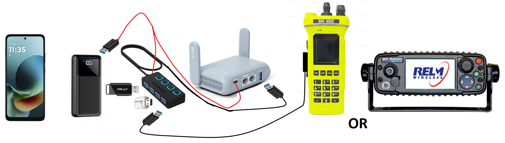
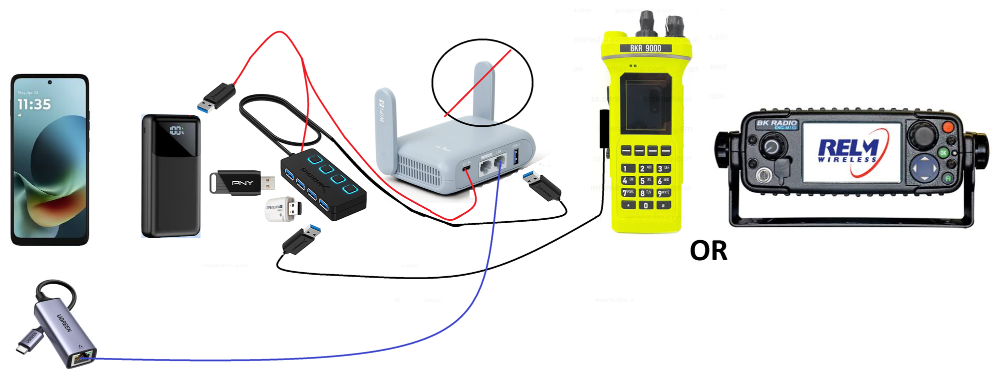

# The Lookout Traveler — design record

*The man-packable, battery-powered Lookout. This file is the **consolidated
archive** for the Traveler — hardware, power, the two configs, and what we've
learned — so none of the design work lives only in chat or memory. Non-public: it
sits in the repo docs but is **not advertised** anywhere (README, site, family
storefront).*

> **STATUS — 2026-11-20: DESIGN ON RECORD. NOT BUILT. NOT PROVEN.** Hardware is
> arriving (MT3000 + PD power bank + VK172 GPS due ~2026-11-20/21); nothing is
> bench-tested yet. It graduates onto the public storefront only after a real box
> is provisioned and a phone pulls the live map off a battery pack — the standing
> "proven workers first" rule. Until then this doc is the memory.

---

## What it is

The fully-wireless, walk-around Lookout. A battery runs the brain (a **GL-MT3000**
travel router); a **portable radio** on its own battery is the relay; a small GPS
gives "you are here"; a **phone is the screen** over the box's own Wi-Fi (or wired —
see configs). Put it in a backpack and it tracks the whole fleet as the operator
walks the incident. The fixed Lookout rides in a vehicle or on a bench; the
Traveler rides on a back.

**The use case that sells it:** the leader who leaves the truck to actually lead —
pushes a line, walks a flank on foot — normally goes *blind*, because the display
stays in the cab. The Traveler puts the whole live picture in their pocket: every
unit the system can hear, while they move. It's the GPS-off-the-radio safety goal
(the "Holy Grail") un-bolted from a vehicle and carried into the fire. Coverage is
the **repeater footprint**, not line-of-sight — the relay just needs clean copy of
the repeater, so a stubby is fine; the network does the long haul.

**Theme:** single user, strip off every part that draws power, use the smallest
pieces that do the job. The map is the whole job.

---

## Platform — GL-MT3000, not the Pi

Decided 2026-11-20. The Traveler is built on the **GL-MT3000 Beryl AX** — the same
OpenWrt/GL family as the fixed Lookout (MT6000), so it's **one platform for both
boxes**: everything proven on the MT6000 (`bk_bridge`, `units_kml`, the one-click)
carries straight over, same code.

The Pi was weighed hard — lower power (~3–5 W vs ~7–9 W), four USB ports (no hub
needed), native ALSA audio, plain-NMEA USB GPS — and **parked**. The deciding
reason: the **GL is self-serve** — a buyer stands it up alone with the manual + one
button — while the **Pi needs AI assistance** to set up (flash, hostapd,
hardening). That self-serve line is the whole product. The MT3000 (512 MB RAM —
huge headroom, the stack measures ~23 MB; Wi-Fi 6; ~$84) is plenty for the light
load. **The Pi's real home is the Signal Shed bench, not the product.**

The one consequence of the GL: it has **one USB port**, so the Traveler carries a
**powered hub** (below) to fan out to radio + GPS + storage. The Pi's four ports
would have avoided it.

---

## Physical build — two configs

### Standard (phone on Wi-Fi)

Phone joins the box's **Wi-Fi**. Radio → **powered USB hub** → the router's single
USB3 port (**data only**). The hub is self-powered off the 5 V rail (its own
17 W / 2.5 A input via a USB-C pigtail) and carries the radio + **VK172 u-blox GPS**
+ thumb drive(s) downstream, so the one router port never sources their current.
Donor radio = **BKR9000** handheld **or** **KNG-M150** mobile.

### Battery-saving (phone wired, Wi-Fi off)

Router **Wi-Fi radio off** (the slashed antenna) and the phone wired in through a
**USB-C→Ethernet adapter** on the LAN port. This kills **both** Wi-Fi radios — the
box's AP (one of the steadiest draws in the whole unit) and the phone's — the
biggest single power saving, and gives a rock-steady wired link with no RF
congestion. It also unlocks a **Wi-Fi-less / LTE-less tablet** as a pure display.
This is the **supported** side of Android USB networking: a phone *hosting* a
standard Ethernet adapter is adopted as `eth0` natively — the opposite of reading
an RNDIS gadget, which Android can't do (see "What we learned"). If the phone needs
charging while wired, use an adapter with **USB-C PD pass-through**.

---

## Hardware

| Part | Role | Notes |
|---|---|---|
| **GL-MT3000 (Beryl AX)** | the brain / Wi-Fi + USB host | 512 MB RAM, Wi-Fi 6; runs the same stack as the MT6000 |
| **Portable radio** — BKR9000 handheld **or** KNG-M150 mobile | the relay (donor radio) | on its own battery; USB = data link (RNDIS), near-zero draw from the box |
| **Powered USB hub** (SABRENT 4-port) | fans the one router port out to radio + GPS + storage | self-powered, 17 W / 2.5 A input fed from the 5 V rail |
| **VK172 u-blox GPS** | "you are here" | serial NMEA — rides `gps_source.py`'s serial branch, no Garmin/libusb path |
| **PD power bank** | the pack | single 5 V rail; USB-C pigtails feed router + hub |
| **USB-C→Ethernet adapter** (UGREEN) | battery-saving config only | phone as host → `eth0`; get the PD-passthrough version if charging while wired |
| **Thumb drive(s)** | map / content storage | optional two-drive split: basemaps vs. situational (see `IDEAS.md`) |
| **Cudy AX3000 AP** (optional) | Wi-Fi range boost | run in **AP / bridge** mode, not router mode |

---

## Power design

- **Single 5 V rail.** Buck output and the battery share one node; an on/off switch
  gates that node; the switch output feeds the GL **and everything else**. There are
  **not** dual 5 V rails — one rail, multiple taps.
- **The hub carries its own power.** It's a *powered* hub (17 W / 2.5 A input), fed
  off the rail via a USB-C pigtail — so the router's one USB port does **data only**
  and never has to source the radio/GPS/drive current. (A hub's "900 mA combined"
  spec note is its *bus-powered* fallback — irrelevant with the adapter in.)
- **Current budget is nowhere near tight.** Radio is self-powered (USB ≈ 0 draw),
  VK172 ≈ 40 mA, a thumb drive ≈ 150 mA on read — a couple hundred mA against the
  hub's 2.5 A. The real rail load is the router itself.
- **Runtime (ballpark — confirm with an inline watt meter):** GL build ≈ 7–9 W for
  the router + the hub's downstream. A ~150 Wh pack ≈ a full shift; ~72 Wh ≈ half;
  ~240 Wh ≈ two shifts. Battery-saving config (Wi-Fi off) extends all of these.

---

## Software — deltas from the fixed Lookout

The Traveler is **opinionated** — stripped and *locked* for singular focus, not a
"lite Lookout." **Absolute simplicity is its north star (Jim, 2026-11-21):** the
discipline is to keep *resisting* "just one more thing" — simplicity here isn't a
finishing phase, it's the product. (Jim, on seeing the palm-sized box + the two-maps-and-
a-dot screen: "the Traveler looks 21st century" — the smallness is the point, where the
fixed Lookout is the hub and earns its size.) It's a **separate standalone program** (its
own copies of the pieces, free to diverge — see #5), with these deliberate differences
from the fixed Lookout:

1. **GPS = VK172 serial NMEA.** `gps_source.py` auto-detects Garmin-libusb → gpsd →
   **serial NMEA**; the VK172 drops onto that third branch. "You are here" comes
   along for free. (No Garmin D800/libusb path on the Traveler.)
   **Why keep the puck even though the phone has GPS:** the display might *not* be a
   phone — a **laptop or a Wi-Fi/LTE-less tablet has no GPS of its own** (and those
   are exactly the displays the wired/Ethernet config opens up). So "you are here"
   can't depend on the screen device; the box carries its own fix. Display-agnostic
   by design — which is also why the phone-GPS-back idea was never the answer here.
   **Proven on real hardware 2026-11-20:** the map runs great on an **Amazon Fire
   HD 10** (Wi-Fi-only, **no LTE, no GPS**, ~$100) over the box's Wi-Fi, with the
   box's own `LOOKOUT` fix plotting "you are here" on it — so both claims above (a
   cheap LTE-less tablet as the display, **and** box-GPS on a GPS-less device) are
   confirmed. (This test was on the current box over Wi-Fi; the wired/Ethernet
   battery-saving path is still to prove.)
2. **Battery-saving config = Wi-Fi off + wired client.** Disable the AP radio; the
   phone/tablet reaches the map over the LAN port through a USB-C→Ethernet adapter.
3. **No audio.** The operator *wears* the portable and listens to its own speaker,
   so the Traveler drops `lookout_audio.py` and the USB sound card entirely. Lighter,
   fewer parts, one less thing to configure.
4. **Locked UI — no map menu, a fixed split-screen (Jim, 2026-11-20).** A Traveler
   operator has *singular focus* (one person, on foot, one incident), so it drops the
   Maps menu entirely and shows **one locked [synced split-screen]**: hybrid on **top**,
   street on the **bottom** (Jim, 2026-11-21 — stacked, not side-by-side: on a portrait
   phone, the Traveler's likely display, two full-width strips beat two skinny columns),
   same grid/zoom, "you are here" centered in both (his canonical pairing: **Mega 4 grid
   Z18 hybrid | Z18 street** — see `IDEAS.md`). No choosing, no fumbling — glance and go.
   **Why this pairing — field rationale (Jim, 2026-11-21):** the two panes do two jobs. The
   **street pane is the tracking view** — in the woods it goes near-empty ("an ocean of
   blue"), and against that emptiness the personnel icons stand out like a sore thumb, so a
   human eye tracks them instantly. The **sat/hybrid pane is the context view** — it fills
   that ocean back in (canopy, clearings, drainage, two-tracks) so you know what the blue
   actually *is*. It's Jim's **OpenCPN instinct realized**: the street pane is the clean
   chart that tracks a unit beautifully (icons popping like boats on open water), the sat
   pane is the imagery-over-land he's chased since the project began — stacked and synced
   instead of chosen between. (Implication: keep the street pane *clean* and unit icons
   *high-contrast* — the emptiness IS the feature; don't clutter it.)
   **Hard rule (Jim, 2026-11-21): the two basemaps
   must be the SAME extent** (ideally the same zoom range too) so the synced panes line up
   — a mismatched pair would pan one pane off its own coverage. Cheap to enforce: the
   server **already** reads each `.tpkx`'s extent (`iteminfo.json` → `extent`
   {xmin,ymin,xmax,ymax}) and zoom (`root.json` → minLOD/maxLOD) to set the map bounds
   (`units_kml.py` line ~105), so the Traveler's split server can **auto-verify the pair at
   startup** — extents match → serve the split; don't match → refuse + a clear red banner
   ("these two maps aren't the same area — a Traveler needs a matching pair"). The
   same-extent rule gets enforced *at the box*, not left to whoever loaded the SSD. (Extent
   is the real sync requirement; zoom-range match is a bonus — same-extent maps with
   different max zoom still sync, one just runs out of detail sooner.) This is what makes the Traveler *distinct*
   from the fixed Lookout (the flexible hub: menu + audio + many viewers), not just a
   smaller copy. The Traveler's box software is its **own standalone program** (its own
   split-screen server + `map.html`), not a mode of the fixed Lookout — see the
   full-independence decision in #5. Depends on building the split-screen feature first
   (`IDEAS.md`).
   - ✅ **Split-screen PROTOTYPE built + function-verified 2026-11-21** (standalone
     `traveler_map.html`; not yet in the repo pending the Traveler product scaffold). Two
     stacked Leaflet panes, **hand-rolled two-way sync** (`src.on("move zoom")` → guarded
     `dst.setView(center,zoom,{animate:false})`), live units on **both** panes, the
     `LOOKOUT` self-unit drawn with a brighter ring + **follow-me** (recenters on your own
     fix unless you pan; a "Re-center on me" button resumes), chrome stripped (no Maps
     menu, no Listen). The **extent guard** is in: it reads both maps' bounds and shows a
     green "✓ Matched pair" or a red "⚠ not the same area" banner. Verified headless
     (Playwright, 12/12): tiles on both panes, a programmatic pan+zoom on one pane mirrored
     by the other (both directions), units on both, guard fires on a mismatched pair.
     Portrait render + the mismatch-warning render delivered to Jim's Downloads
     (`Traveler_SplitScreen_*`). Reacts-to list for Jim: top/bottom layout, the look,
     follow-me behavior, and warn-vs-hard-refuse on a mismatch. *Goes live on the box over
     the real two-map SSD once it finishes loading.*
5. **Two FULLY INDEPENDENT products — zero shared base (Jim, 2026-11-21).** The Lookout
   and the Traveler are **separate standalone products**, exactly like every other tool
   in the family (Parcel100 vs mb2tpkx vs Object Factory — none share a "base," and none
   ever should). A **Traveler box carries only Traveler files; a Lookout box only Lookout
   files**; installing one never puts a single file of the other on the box, and there is
   **no runtime mode flag**. A person can have just a Traveler, just a Lookout, or both —
   they never interact. This holds for **both layers**: the box software (its own server +
   `map.html` + boot scripts) **and** the PC setup app — a **completely separate Traveler
   Manager**, zero shared files with Lookout Manager (the setup flows barely overlap:
   serial GPS not Garmin/radio, no audio, welded split-screen, friendly-address + SSID;
   each is its own obvious `.bat` + manual, the packaging standard). **No shared core, no
   shared module** — an earlier idea to share a setup/engine module was dropped as
   over-engineering: it's coupling that exists nowhere else in the family. The few files
   that start identical (`gps_source.py`, `bk_bridge.py`) get their **own copy** in each
   product and are free to **diverge** for each product's needs (the Traveler likely wants
   a no-radio, self-GPS-only bridge with no RADIO LINK DOWN alarm — a shared file would
   fight that). A shared-logic fix, if ever needed, is a trivial copy to both — cheap, and
   the family norm. Built AFTER the manual bench recipe is proven (it becomes the
   Traveler's own setup steps).

---

## What we learned (so it's never re-derived)

- **The phone can't host the radio.** Android's framework won't adopt a USB **RNDIS
  gadget** (`usb0`-style) as a network interface — it only takes `eth\d`-named
  interfaces — and apps can't bring one up without root. Researched 2026-11-20
  across every analog (PlutoSDR→Android, single-board→tablet): **nobody has cracked
  generic RNDIS-on-stock-Android.** The ones who "got it working" reconfigured their
  device to ECM, rooted it, or reversed roles. → **The router (USB host) is
  irreducible.** This is *why* the box exists.
  - Note the clean distinction: a phone *hosting* a normal USB-C→**Ethernet adapter**
    (battery-saving config) is the **supported** case and works natively. Reading an
    RNDIS gadget is the unsupported one.
- **Any browser, any device — the display is a cheap, swappable consumable.** Wi-Fi
  + a browser is universal (proven even on the Fire HD 10's oddball **Amazon Silk**
  browser), so there's no device to qualify and no app to install. Break the tablet,
  pull your phone — nothing lived on the screen. Fleet buy = cheap and plural; rugged
  only for a genuinely exposed role. Full write-up: [`docs/BROWSER_MAP.md`](BROWSER_MAP.md) §2a.
- **How BK delivers GPS → [`docs/BK_GPS_DELIVERY.md`](BK_GPS_DELIVERY.md).** The
  Lookout taps BK's own base-radio-over-USB gateway (the `pkgcot.exe` path), format
  reverse-engineered (`NMEA + $PP25`). No public BK API/SDK.
- **BK Bluetooth / LocateONE Lite is sealed.** Full probe of the radio's BLE +
  classic RFCOMM (btvs/Wireshark HCI capture) confirmed position never flows to a
  generic client — it's gated behind LocateONE's handshake. **Don't re-chase it.**

---

## Open / to prove (build order when the MT3000 lands)

*Planned bench day: 2026-11-21.*

### ✅ BENCH RESULTS 2026-11-21 — GPS chain PROVEN end to end

- **Carton firmware: GL v4.11.0 / OpenWrt 21.02-SNAPSHOT (r15812+926-46b6ee7ffc) / kernel 5.4.211.** Same generation the MT6000 was proven on; the point release differs (5.4.211 vs the MT6000's 5.4.238) because it's a different radio — immaterial, since GL's `opkg` feed is kernel-matched, and the Traveler has no audio (the one kmod that's fussy about the exact kernel). No pending update; went straight to work.
- **Powered SABRENT hub enumerated clean:** GenesysLogic USB2.1 + USB3.1 Hub (`05e3:0610` / `05e3:0626`). The VK172 hangs off it and is powered — the self-powered-hub design works.
- **VK172 seen on the bus with NO driver install:** `Vendor=1546 ProdID=01a7`, `u-blox 7 - GPS/GNSS Receiver`.
- **GPS driver needs ZERO internet — the carton firmware already ships `kmod-usb-acm`** (`5.4.211-1`), plus `kmod-usb-serial*`. It just wasn't *loaded*: `modprobe cdc-acm` created `/dev/ttyACM0` instantly (`cdc_acm 1-1.1:1.0: ttyACM0: USB ACM device`). **Correction to the plan below (step 2): the GPS is fully offline-provisionable; the only internet-once need is `python3` + `python3-pyserial`, not a GPS kmod.** ⚠ `cdc-acm` is **not auto-loaded at boot** — the boot/init step must `modprobe cdc-acm` (or add it to `/etc/modules.d/`) or a rebooted Traveler comes up with no GPS node.
- **LIVE 3D FIX proven** (`timeout 6 cat /dev/ttyACM0`): valid `$GPGGA`/`$GPRMC` (status A) at **30.3938° N, 81.9377° W** (Nassau County — the same spot the MT6000's Garmin put it), **6 sats, HDOP 1.35**. The full Traveler GPS chain — VK172 → powered hub → MT3000 → cdc-acm → `/dev/ttyACM0` → valid NMEA — is proven. `gps_source.py`'s serial branch (`SerialSource`, needs pyserial, probes 4800/9600) reads exactly this.
- **DONE on the bench 2026-11-21:** GPS chain; `python3` + `python3-pyserial` install; the stock stack serving a **live `LOOKOUT` "you are here" map to a plain PC browser** over the box's Wi-Fi (step 3 above). **Still to do (continuing):** plug the map SSD for a basemap under the dot (watch for NTFS/exFAT mount support), friendly address (`a.lan` + port-flip + SSID via `uci`), battery-saving wired config, runtime, the Traveler's own standalone files + split-screen.

1. **Bare-box recon.** The MT3000 is carton-fresh — **capture the shipped firmware
   first**: `cat /etc/glversion; uname -r` **before** updating (standing open item:
   log a truly-new box's shipped version; also tells us if MT3000 4.11.0 is the same
   OpenWrt-21.02 / kernel-5.4.238 generation the MT6000 was proven on). **Target =
   GL v4.11.0 stable** (released 2026-09-28, same major as the MT6000 baseline; a
   4.11.1 *beta* exists — skip it). The box may already be on 4.11.0 (**no pending
   update** — just go) or ship older and get offered it. **Firmware-first is LOWER
   stakes here than on the MT6000:** that landmine was driven by the kernel-matched
   `kmod-usb-audio`, and **the Traveler drops audio** — so even on older firmware
   we're not in the audio-mismatch danger zone; the box just needs USB-net host (for
   the radio) + USB-serial (for the VK172), both standard. *Then* firmware update if
   one's offered, and look at USB host behavior / how the one port enumerates the
   powered hub, and RAM/footprint sanity.
2. ✅ **VK172 through `gps_source.py`'s serial branch (PROVEN 2026-11-21).** u-blox-7
   enumerates as CDC-ACM → `/dev/ttyACM0`. **`kmod-usb-acm` ships in the carton
   firmware** (not the expected extra install) — it only needed `modprobe cdc-acm` to
   load, so the GPS costs **no** internet. The one internet-once need is `python3` +
   `python3-pyserial`. Live 3D fix confirmed at the bench (see BENCH RESULTS above).
   The boot/init step must load `cdc-acm` (not auto-loaded on this firmware).
3. ✅ **Standard config — map serving + self-GPS PROVEN 2026-11-21.** With `python3` +
   `python3-pyserial` installed (the one internet moment), the stock Lookout stack
   (`bk_bridge` + `gps_source` + `units_kml` + `map.html`/leaflet, fetched to `/root`) was
   run by hand: `bk_bridge` picked up the VK172 on `gps_source`'s serial branch
   (`serial NMEA /dev/ttyACM0 @ 4800`) and broadcast the box as unit `LOOKOUT`;
   `units_kml` (v1.12) read it off `:10110` and served `:8080`; a plain Edge browser on
   the PC at `http://192.168.8.1:8080/` showed **`LOOKOUT · now`, 1 unit green** — a live
   "you are here" over the box's Wi-Fi, nothing installed on the PC. (Bench had no radio,
   so the expected `RADIO LINK DOWN` banner showed — the Traveler's own bridge will drop
   it; and no SSD, so the map drew dark under the dot.) This used the stock Lookout files
   purely to prove the platform; the Traveler's own standalone files come later.
   *Next: plug the map SSD into the hub so a basemap draws under the dot.*
4. **Friendly address (new design 2026-11-20).** Do it via **`uci`**, the box's
   official config interface — **not** LuCI (the LuCI GUI is broken on these boxes;
   `uci` is the engine underneath and is always present), so the one-click can apply
   it with no human GUI step. Two parts:
   - **Short name:** a dnsmasq host entry `a.lan → 192.168.8.1` (`uci` on
     `/etc/config/dhcp`, commit, reload dnsmasq). A dotted name reads as a URL (not a
     search). A real TLD like `.com` was rejected because a cell-data device could
     launch to the real site. **TLD status (checked 2026-11-20):** `.lan` is
     *de-facto* private, not officially reserved — it's undelegated (nobody owns it
     publicly) and is the GL/OpenWrt **default** local domain, so it's leak-safe in
     practice and needs zero setup, and it's the shortest (5 chars). The **only**
     officially-reserved private TLD is **`.internal`** (ICANN, Aug 2024) — guaranteed
     never public, but 10 chars and not the router default. For an offline box `.lan`
     is fine (native + short); use `.internal` if you want the official guarantee.
     **Browser handling (checked 2026-11-20):** no major browser special-cases
     `.internal` by name yet (too new). But Chrome's HTTPS-First / 2026 HTTPS-by-default
     **exempts** private IPs, `localhost`, single-label names, and **"non-unique"
     hostnames** (any non-public-registry TLD) — so `a.lan` *and* `a.internal` both
     ride the non-unique exemption on desktop Chrome, and the 2026 push targets
     **public** sites (private/intranet/local-IP treated as lower-risk). A LAN box
     isn't the crackdown's target. `.internal`'s future edge: its official reservation
     gives browsers a clean hook to add it to local/non-unique allowlists explicitly,
     which `.lan` lacks. Caveat: that's desktop-Chrome documented behavior; **mobile**
     browsers (Silk, the typed-address upgrades) are messier — so the IP + bookmark/QR
     stays the bulletproof path, the name is the convenience layer.
     **Don't shorten the TLD to save characters (checked 2026-11-20):** DNS allows
     1-char labels, but **every 2-letter TLD is a real country code** (`.la` = Laos,
     etc.), which reintroduces the `.com` leak + public-https problem — avoid all of
     them. A 1-letter TLD (`a.a`) is undelegated/leak-safe but browsers less reliably
     treat it as a URL (vs a search). `.lan` is already optimal: non-public, OpenWrt's
     **default** local domain (zero config), reliably URL-shaped, and `a.lan` already
     makes the smallest possible QR (**version 1** — can't shrink). The 2 saved chars
     aren't worth the ccTLD trap or the flakiness.
   - **Port-flip:** serve the map on **:80** (one-line change in *our* `units_kml`
     config) and move the GL admin off :80 to **:8080** (`uci`), so `a.lan` opens the
     **map**, not the admin login (a name with no port = :80 = admin today — the same
     trap as `http://…:8080` dropping to the login page).
   - **Bench-confirm:** that freeing :80 from admin is clean on this firmware (the
     "test it first" part — SSH is the backstop against lockout), and how `a.lan`
     behaves *typed* on the Fire and a phone (https-upgrade, dual-homed WiFi+cell
     resolve). **Same recipe applies to the MT6000** (same GL/OpenWrt/`uci`).
   - **Productization → the setup managers.** This friendly-address feature is useful to
     **both** the new **Traveler Manager** and the fixed Lookout Manager — each implements
     it in its own code (no shared module; see delta #5). Once proven, add a **"Name this
     site" field** to the setup UI: the user types a label (e.g. `abcd`),
     Manager **appends `.lan` itself** and writes the dnsmasq entry + applies the
     port-flip, so one-click yields `abcd.lan` → the map. Blank = plain IP.
     **Safety-by-design:** because Manager owns the `.lan` suffix, a user can't pick a
     real TLD (`.com`) and reintroduce the cell-data leak — the safe suffix is enforced
     by the tool, not the person. Naming *implies* the port-flip (a name with no port
     hits admin otherwise), so they package as one feature. Doubles as a human label
     for multi-box outfits (`north.lan`, `truck7.lan`).
   - **One name, both jobs (Jim 2026-11-20).** The same "Name this site" field also
     sets the **WiFi SSID** (`uci` `wireless`, both 2.4 + 5 GHz radios) to that name,
     so the network you *join* and the address you *open* are the identical string —
     "connect to `a.lan`, go to `a.lan`." One word, learned once, does both. Its real
     value isn't about user skill — it **removes the arbitrary URL-quirk surface**
     (the `http://`-vs-bare reversal, a bare name silently hitting the admin login,
     the https auto-upgrade) that ambushes *anyone*, novice or expert, because those
     behaviors are browser *guesses*, not logic, and they aren't even consistent
     device to device. Delete the typing and the guesswork never gets a turn. The SSID
     also becomes each box's visible identity for multi-box outfits. **Self-documenting — you don't even have to remember the
     address:** it's the name of the WiFi you're already connected to, so if you
     forget it, glance at your device's WiFi settings and the connected network *is*
     what to type. The box carries its own reminder on the one screen every user
     already checks. **Bench caveat:** changing the SSID drops any device
     currently on that WiFi (the setup PC included if it's on WiFi), so Manager sets
     the SSID **last** and tells the user to rejoin the renamed network — **or** run
     setup over the box's **LAN/Ethernet port** so the control link never rides the
     WiFi being renamed. Prove the ordering on the bench.
   - **Caveat:** the plain IP + bookmark (handed-out tablets) / QR (BYOD phones) stays
     the leak-proof, scheme-proof default — the friendly name is for placards and
     word-of-mouth, not a replacement.
5. **Battery-saving config** — Wi-Fi off + USB-C→Ethernet client comes up as `eth0`
   and pulls the map over the wire.
6. **Real battery-runtime measurement** with an inline watt meter, both configs.
7. **Two-thumbdrive split** (basemaps vs. situational) — see `IDEAS.md`.

Then decide whether it graduates onto the README/site as the second body in the
product line: **The Lookout** (MT6000, vehicle/mains) + **The Lookout Traveler**
(MT3000, battery, man-packable) — same brain, two bodies.

---

## Cross-links

- **Origin idea + narrative:** [`docs/IDEAS.md`](IDEAS.md) (the Traveler entry).
- **BK GPS delivery:** [`docs/BK_GPS_DELIVERY.md`](BK_GPS_DELIVERY.md).
- **The fixed Lookout:** [`README.md`](../README.md), [`docs/DEVELOPERS_GUIDE.md`](DEVELOPERS_GUIDE.md).
