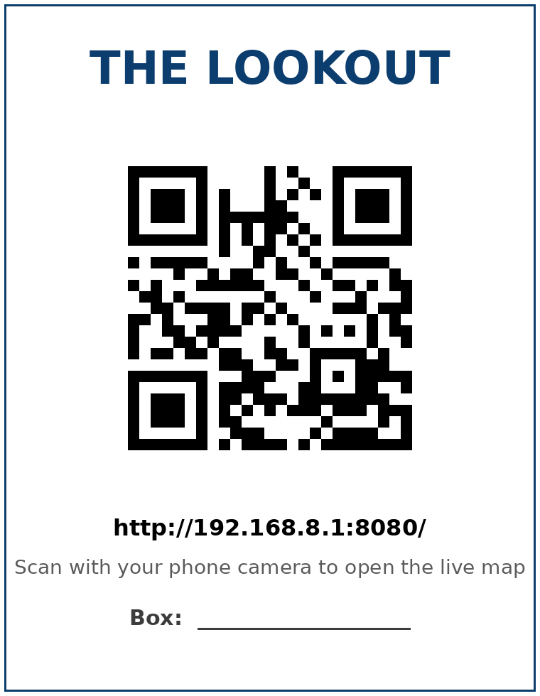

# Lookout QR Maker

Make a printable QR card that opens the Lookout map on a phone — just by scanning.

> **Installing Lookout QR Maker — read this first**
> - Right‑click the downloaded zip and choose **Extract All** before using it.
> - Open the folder and double‑click **`Make a QR card.bat`** — that one file is all you click.
> - If Windows shows a blue "Windows protected your PC" notice, click **More info → Run anyway**.
> - The first time, it installs one small graphics helper (Pillow) by itself — let it finish.
> - Then the Lookout QR Maker window opens. Nothing else to set up, and it never needs the internet.

A printable copy of this guide is **Lookout QR Maker.pdf**, right next to the `.bat`.

---

## What it's for

When you *type* an address like `192.168.8.1:8080` into a phone, the phone forces it to `https` and the page won't open. A QR code carries the `http://` part explicitly, so a camera scan opens the map the right way with no typing. Print the card, tape it inside the truck or on the Lookout box, and anyone can scan to see the live map.

## How to use it

1. In **Router address**, type the full address you want the QR to open — for the Lookout that's **`192.168.8.1:8080`** (the `:8080` is the port the map serves on, so include it). You can also paste a full deep link to one named map.
2. It encodes **exactly what you type**, adding only the invisible `http://` in front so the scan opens cleanly. It does **not** add the port or a trailing slash for you — what you type is what the QR carries, so the shortest address you type is the shortest link it makes.
3. **Box name** is optional — type the unit or truck name and it prints on the card. Leave it blank and the card has a line to write it on.
4. Click **Make QR card**. The card is saved to your Desktop as a `.png` picture and opens so you can see it. **The card prints the full `http://` address it encodes**, so you can read it back and confirm it before printing.
5. Print it. Any printer is fine — the black‑and‑white card scans cleanly at business‑card size or larger.

### Just the QR code (no card)

Tick **Just the QR code (no card)** before clicking Make, and you get the bare QR square with the address beneath it and nothing else — no banner or border. Use it when you want to drop the code into your own sticker, sign, or sheet.

## Good to know

- Scan with the phone's normal camera app — no special QR app needed.
- Works for any address up to **78 characters**, which covers a plain box address or a full deep link to one named map (e.g. `.../m/b-mega-4-grid-z-16-bing/`).
- The phone and the Lookout must be on the same network (the box's Wi‑Fi) for the map to load after scanning.
- Because every Lookout uses the same address, one printed card works for every box.

## What's in the folder

- **`Make a QR card.bat`** — double‑click this
- **`Lookout QR Maker.pdf`** — this manual
- **`System Files`** — the program; leave it alone
- **`Lookout_QR_<address>.png`** — the card it makes, on your Desktop

---

*Part of **The Lookout** — a plug‑in box that puts live units and offline maps on any phone or PC, with nothing installed on the viewer. Free, offline, open. https://github.com/Jim-dc95811/The-Lookout*
